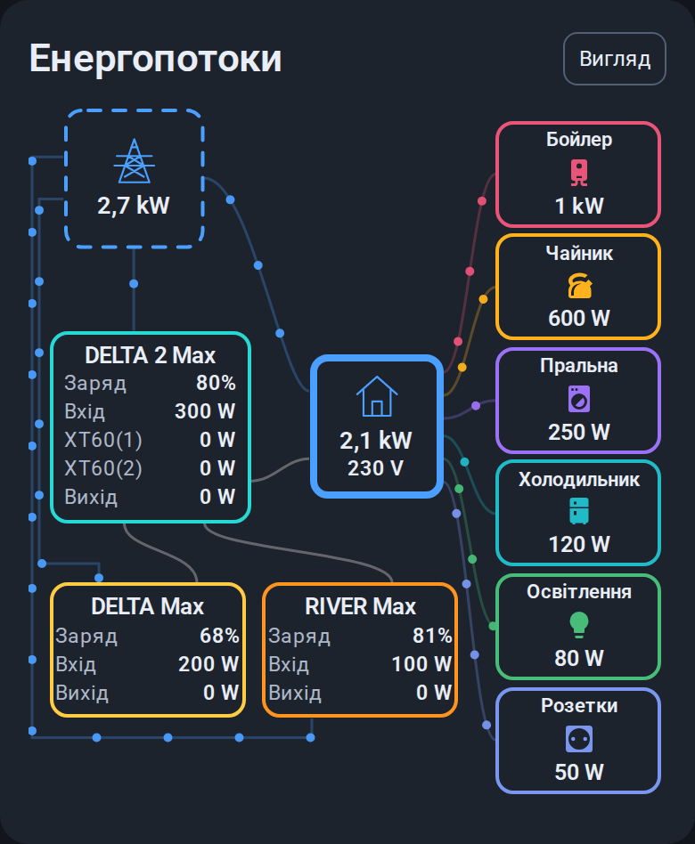
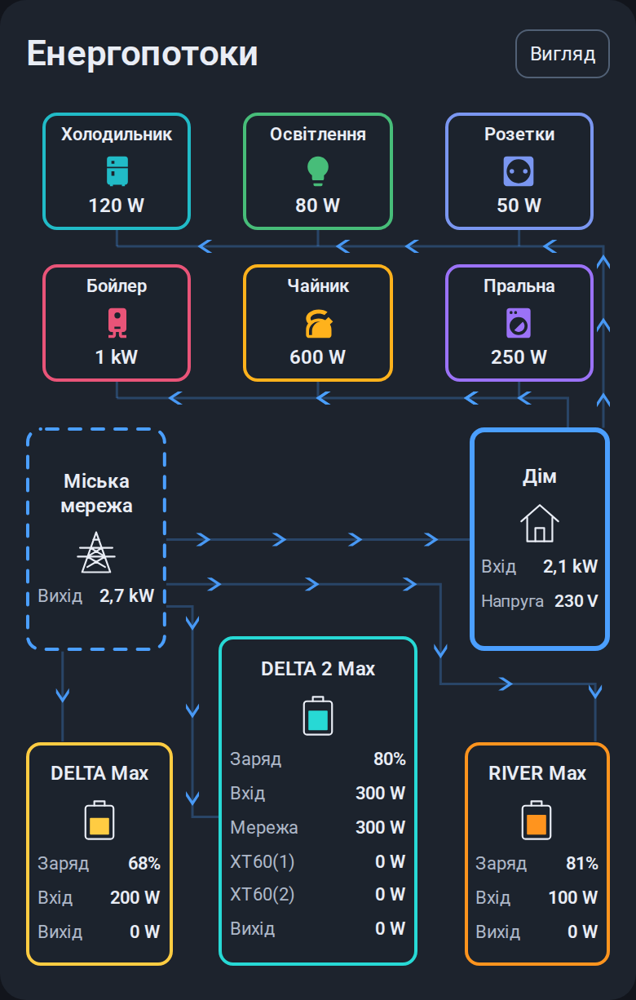
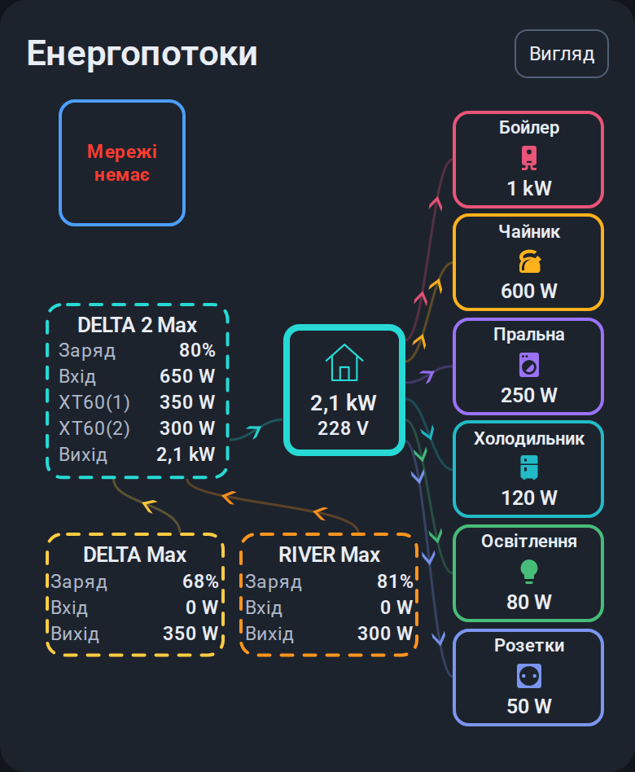
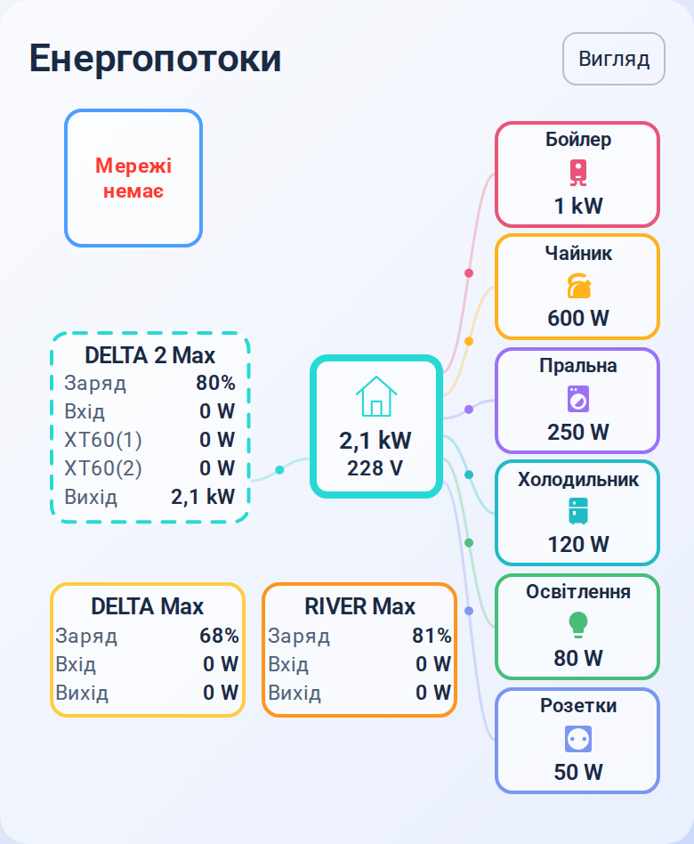
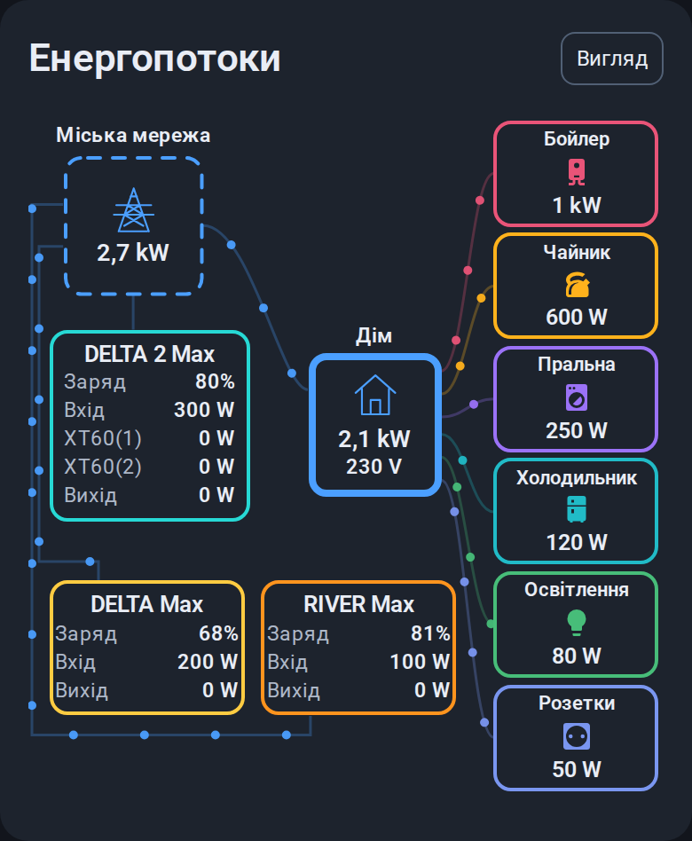

# Suris EcoFlow Flow Card 2.1.3-beta.2

[English](README_EN.md) · [Стабільний реліз 2.1.1](https://github.com/Suris2009/suris-ecoflow-flow-card/releases/tag/v2.1.1) · [Завантажити JS](https://github.com/Suris2009/suris-ecoflow-flow-card/releases/download/v2.1.3-beta.2/suris-ecoflow-flow-card.js)

**Бета на базі 2.1.1.** У HACS увімкни показ бета-версій. [Зміни](RELEASE_NOTES.md).

Картка енергопотоків для Home Assistant, яка показує міську мережу, три станції EcoFlow, дім та індивідуальні споживачі в одній схемі.

**Потоки повторюють зміни споживання.** Кожна лінія реагує на власні показання потужності: більше споживання — швидший рух, менше — повільніший. Напрямок показує передачу енергії від джерела до споживача. Показники, активність ліній і швидкість оновлюються разом із датчиками Home Assistant. Однакова потужність дає однакову швидкість незалежно від довжини маршруту.

- **Два вигляди в одній картці.** Класичне розташування та компактний «Боковий потік». Перемикання кнопкою «Вигляд»; вибір запам’ятовується для цієї картки у поточному браузері.
- **До шести споживачів одночасно.** Можна налаштувати до 20 приладів. Якщо активних більше шести, показуються найпотужніші. Решта зберігають свої місця, а неактивні прилади приховуються.
- **Окремі маршрути до приладів.** У «Боковому потоці» кожен споживач має повну власну лінію від дому в кольорі приладу. У класичному вигляді точки та стрілки проходять спільну лінію й повертають до свого споживача.
- **Настроювані кольори.** Окремі кольори міської мережі, кожної станції та кожного приладу. Є готові зразки, палітра, змішування відтінку, насиченості й яскравості та повернення типового кольору. Рамка дому автоматично має колір його джерела живлення.
- **П’ять анімацій.** Рухомі штрихи, точки, стрілки, пульсуючі світлові смуги та одна рухома точка. Розмір точок регулюється від 2 до 10 px.
- **Регулювання швидкості та порога активності.** Загальну швидкість руху можна змінювати в редакторі, а кожна лінія додатково реагує на свою потужність. Оновлення показників змінює швидкість без перезапуску анімації. Неактивні лінії приховані.
- **Усі основні показники.** Заряд, вхід і вихід трьох станцій; два входи XT60(1)/XT60(2) головної EcoFlow. Для дому — потужність і необов’язковий датчик напруги. Значення автоматично відображаються у W або kW.
- **Автоматичне визначення живлення дому.** Джерело визначається за показаннями потужності. Окремий датчик потужності дому необов’язковий: картка може використовувати вихід головної EcoFlow або розрахунок від мережі з відніманням заряджання станцій.
- **Попередження про відсутність мережі.** За налаштованим датчиком у блоці мережі блимає напис «Мережі немає». Джерела, що віддають енергію, мають рухомі пунктирні рамки за годинниковою стрілкою; рамка дому залишається суцільною.
- **Назви, іконки та докладні дані.** У «Боковому потоці» назви приладів показані одним рядком, довгі скорочуються двома крапками; повна назва є в підказці. Іконки вирівняні між назвою та потужністю. Натискання показника з налаштованою сутністю відкриває її докладну інформацію.
- **Мобільний інтерфейс і теми.** Світле й темне оформлення, компактний боковий вигляд та автоматичне зменшення висоти класичного вигляду, коли ряд споживачів не потрібен. Підтримується системне зменшення руху.

Налаштування — через візуальний редактор, без обов’язкового YAML. Інтерфейс українською та англійською. Картка працює локально з наявними сутностями Home Assistant; для неї не потрібні зовнішні бібліотеки чи CDN. Встановлення та оновлення — через HACS або одним JS-файлом. Наявні налаштування картки зберігаються після оновлення.

## Скриншоти

Скриншоти реальної картки з демонстраційними показниками. Назви станцій, датчики та кольори налаштовуються.

| Боковий потік: мережа та заряджання станцій | Класичний вигляд із тими самими показниками |
| --- | --- |
|  |  |

| Живлення від EcoFlow та два входи XT60 | Відсутність міської мережі, світла тема |
| --- | --- |
|  |  |

## Встановлення та оновлення

Додай `https://github.com/Suris2009/suris-ecoflow-flow-card` як користувацький репозиторій HACS для карток панелі огляду (Dashboard), встанови **2.1.3-beta.2** та перезавантаж інтерфейс Home Assistant. Додай картку **Suris EcoFlow Flow Card** на панель і вибери сутності у візуальному редакторі.

Ресурс HACS: `/hacsfiles/suris-ecoflow-flow-card/suris-ecoflow-flow-card.js`, тип **JavaScript module**. Якщо ресурс уже додано, використовується той самий файл.

Для ручного встановлення завантаж JS-файл із релізу, поклади його до `www` у каталозі конфігурації Home Assistant та додай ресурс `/local/suris-ecoflow-flow-card.js?v=2.1.3-beta.2` типу **JavaScript module**. Якщо каталог `www` створено вперше, перезапусти Home Assistant.

При оновленні зі стабільної 2.0.8 або бети 2.1 налаштування сутностей, приладів, кольорів і анімації зберігаються. Наявні картки початково використовують класичне розташування; збережений у браузері вибір бокового вигляду також залишається. Дублювати картку чи JS-ресурс не потрібно.

Картка використовує наявні сутності Home Assistant. Інтеграції EcoFlow, лічильників та розумних розеток мають надавати показники потужності.

## Перемикання вигляду

Натисни **Вигляд** у заголовку. У редакторі **Вигляд потоків → Розташування блоків** можна обрати початковий вигляд, а параметр **Кнопка перемикання вигляду** керує видимістю кнопки.

| Вигляд | Споживачі та лінії |
| --- | --- |
| Класичний | Два ряди по три прилади; спільні лінії рядів у кольорі дому та відгалуження до приладів. Висота зменшується, якщо ряд не потрібен. |
| Боковий потік | Шість приладів праворуч; окрема повна кольорова лінія від дому до кожного. Однакові прямокутники, назва одним рядком, іконка та потужність. |

```yaml
appearance:
  layout: sideflow
  show_layout_switch: true
```

`layout` приймає `classic` або `sideflow`. Вибір кнопкою зберігається локально для цієї картки й браузера; він не змінює налаштування датчиків.

## Назви мережі й дому

У блоках **Міська мережа** та **Дім** введи текст у полі **Назва** й увімкни **Показувати назву над блоком у боковому вигляді**. Назви вмикаються окремо та показуються над відповідними рамками. Довгі назви скорочуються, а повний текст доступний у підказці. За замовчуванням назви приховані; висота картки не збільшується.



## Індивідуальні споживачі

У візуальному редакторі натисни **Додати споживача**, введи назву, вибери датчик потужності, іконку та колір. Можна налаштувати до **20 приладів**, одночасно показуються до **шести активних** із найбільшою потужністю.

Активність означає потужність **вище** налаштованого порога, типово 3 W. Нульові, від’ємні, невідомі та недоступні значення не показуються. За однакової потужності вже показані прилади мають пріоритет. Прилади, які залишаються на екрані, зберігають місця; вільні місця заповнюються автоматично.

Потрібен датчик **потужності W / kW**, а не накопиченої енергії Wh / kWh. Список приладів показує частину споживання дому й не підміняє загальний вхід дому сумою шести видимих приладів.

У боковому вигляді довга назва закінчується двома крапками (`..`), повна назва доступна в підказці. У класичному вигляді збережено стандартне скорочення. Натискання потужності відкриває докладну інформацію про її сутність.

## Датчики станцій, мережі та дому

| Блок | Налаштування |
| --- | --- |
| Міська мережа | Потужність; необов’язковий датчик наявності мережі та стан «мережа є». |
| Кожна допоміжна станція | Заряд (%), загальний вхід і вихід; необов’язково окремі потужності заряджання від мережі та передачі на головну станцію. |
| Головна EcoFlow | Заряд (%), загальний вхід і вихід, окремий AC-вхід, два DC-входи XT60(1)/XT60(2); необов’язково окремий вихід на дім. |
| Дім | Необов’язкові датчики потужності та напруги; напруга показується під потужністю у V. |

Джерело дому визначається за потужністю виходу головної станції на дім. Якщо вибрано окремий датчик цього виходу, він має пріоритет над загальним виходом. Потужність вище порога означає живлення від EcoFlow; доступний невід’ємний показник на порозі або нижче — від мережі. Якщо вихід EcoFlow недоступний, додатна потужність мережі вище порога дає можливість визначити живлення від мережі.

Без окремого датчика потужності дому:

- Від EcoFlow використовується її вибраний вихід на дім.
- Від мережі: потужність мережі мінус заряджання двох допоміжних станцій і AC-вхід головної. Відсутні або недоступні показники заряджання у цьому розрахунку вважаються нулем.

Для допоміжної станції можна окремо вибрати **Потужність заряджання від мережі**, якщо загальний вхід включає інші джерела, та **Потужність передачі на головну EcoFlow**, якщо загальний вихід включає інші навантаження. Для лінії мережа → головна EcoFlow використовується лише її окремий AC-вхід.

Якщо загальний вхід головної станції не вибрано, він може обчислюватись як сума вибраних AC- та XT60-входів, коли всі ці показники доступні.

Датчик наявності мережі керує лише попередженням **«Мережі немає»** і приховуванням її вихідної потужності. Він не керує вибором джерела дому. Можна задати стан «мережа є» як `on` або `off` відповідно до свого датчика.

Підтримуються W, kW, mW, MW, Вт та кВт; без одиниці показник вважається W. Недоступне значення показується як `—`, справжній нуль — як `0 W`. Заряд батареї відображається за показниками 0–100%; у класичному вигляді заповнення значка батареї відповідає заряду.

## Анімація, швидкість і кольори

У розділі **Вигляд потоків**:

| Параметр | Значення |
| --- | --- |
| Анімація | Штрихи, рухомі точки, рухомі стрілки, пульсуючі смуги або одна рухома точка. |
| Розмір точок | 2–10 px для обох режимів із точками; типово 5 px. |
| Базовий час руху | 0,5–20 с; більше значення сповільнює всі потоки, типово 3 с. |
| Поріг активного потоку | Потужність має бути строго вище порога; типово 3 W. |
| Кольори | Окремо мережа, EcoFlow №2, EcoFlow №3 та головна станція; колір приладу — в його власному розділі. |

Швидкість залежить від потужності відповідної лінії: від показаного входу дому, заряджання станції чи її виходу передачі. У класичному вигляді спільна лінія ряду використовує суму потужностей показаних приладів цього ряду; точки та стрілки безперервно проходять увесь маршрут до приладу. У режимі однієї точки на спільному ряду вона відвідує його прилади по черзі.

Рухомі точки мають на 30% меншу щільність порівняно з 2.0.8: на окремих лініях відстань становить 40 px замість 28 px, а кількість точок на спільних маршрутах округлюється до 70% попередньої, щонайменше одна. Швидкість руху збережена.

Для кольорів є зразки, системна палітра, змішування HSL та скидання до типового. Підтримуються назви CSS-кольорів, HEX, RGB/RGBA та HSL/HSLA. У текстовому полі редактора лапки не потрібні. Прозорість можна задати текстом.

Колір джерела застосовується до його рамки й вихідних потоків. Дім має колір активного джерела; у боковому вигляді індивідуальні лінії мають кольори приладів. Активні рамки джерел рухаються за годинниковою стрілкою; рамка дому товща, суцільна й нерухома.

Анімації виконує браузер без покадрових JavaScript-таймерів. При приховуванні неактивної лінії або від’єднанні картки рух призупиняється. За системного зменшення руху активні лінії статичні.

## Демонстрація та перевірки

`demo.html` показує вигадані дані й дає змогу перемикати джерело, заряджання, активність приладів та анімації. Відкрий його поруч із JS-файлом у браузері.

Для роботи картки Node.js не потрібен. Для розробників: `npm install`, `npx playwright install chromium`, `npm test`. За потреби `SURIS_CHROMIUM_PATH` задає шлях до готового Chromium. `npm run previews` створює наведені скриншоти з реальної картки, Roboto та стандартними Material Design Icons; ці залежності використовуються лише для створення скриншотів.

Перевірки охоплюють джерела живлення, одиниці, відсутні дані, вибір шести приладів, редактор, кольори, усі п’ять анімацій, розташування від 320 до 1150 px, центрування іконок, скорочення назв, перемикання вигляду та зменшення руху. [Історія змін](CHANGELOG.md) · [Випуск версій](RELEASING.md).
