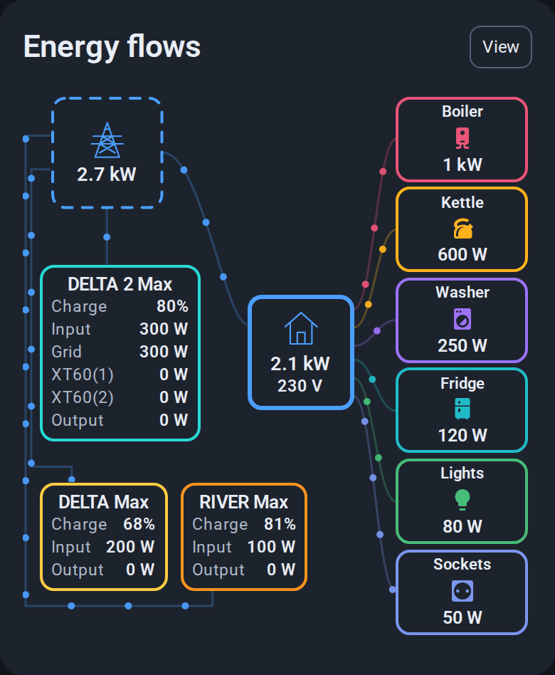
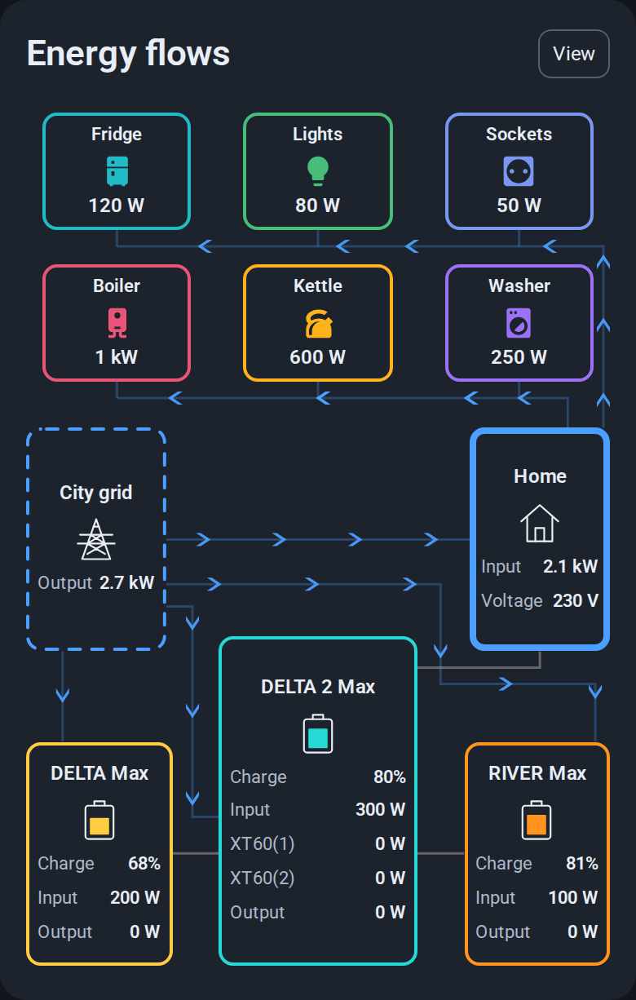
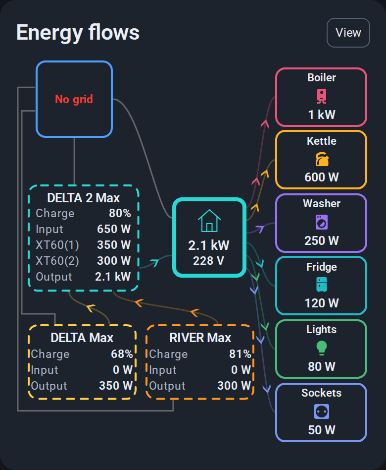
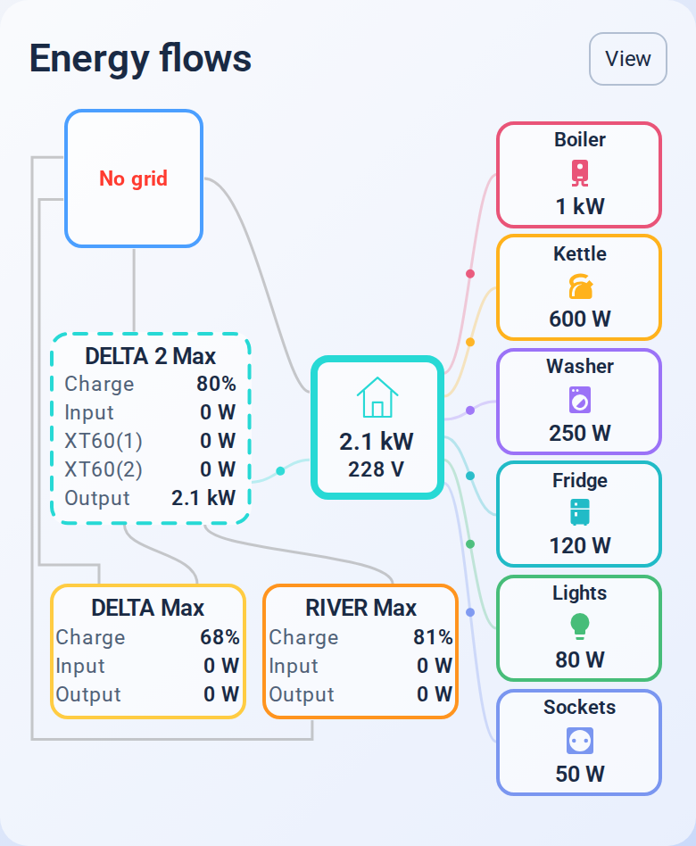
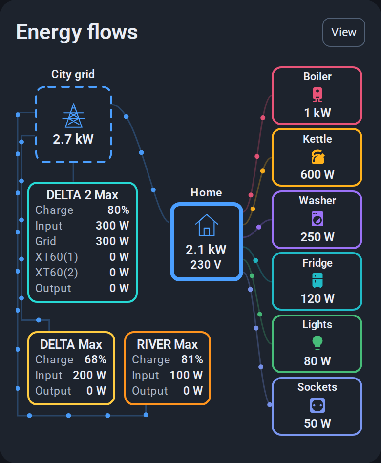

# Suris EcoFlow Flow Card 2.1.3

[Українська](README.md) · [Stable release 2.1.3](https://github.com/Suris2009/suris-ecoflow-flow-card/releases/tag/v2.1.3) · [Download JS](https://github.com/Suris2009/suris-ecoflow-flow-card/releases/download/v2.1.3/suris-ecoflow-flow-card.js)

**Stable release 2.1.3.** [Changes](RELEASE_NOTES.md).

A Home Assistant energy flow card that brings the city grid, three EcoFlow stations, Home and individual consumers into one diagram.

**Flows follow changes in consumption.** Each line responds to its own power readings: higher consumption makes movement faster; lower consumption slows it down. Direction shows energy moving from its source to its consumer. Readings, active connections and animation speed update with Home Assistant sensors. Equal power produces equal visual speed regardless of route length.

- **Two views in one card.** Switch between Classic and compact Side flow with the View button. The selection is remembered for this card in the current browser.
- **Up to six consumers at once.** Configure up to 20 devices. If more than six are active, the highest-power devices appear. Retained devices keep their positions, and inactive consumers are hidden.
- **Complete routes to each device.** In Side flow, every consumer has a separate, complete line from Home in its own color. In Classic, dots and arrows follow the shared feeder and turn into the appropriate consumer branch.
- **Custom colors.** Set separate colors for the city grid, each station and each device. Choose presets, use a palette, mix hue, saturation and lightness, or restore defaults. Home’s border automatically takes the color of its power source.
- **Five animations.** Moving dashes, dots, arrows, pulsing light strips and one moving dot. Dot size is adjustable from 2 to 10 px.
- **Adjustable speed and activity threshold.** Set the overall movement speed in the editor; each line also responds to its own power. Live readings adjust speed without restarting the animation. Inactive connections stay hidden.
- **All key readings.** Battery charge, input and output for three stations; two XT60(1)/XT60(2) inputs for the main EcoFlow. Home shows power and optional voltage. Values automatically use W or kW.
- **Automatic Home source detection.** Power readings determine the source. A separate Home power sensor is optional: the card can use main EcoFlow output or calculate Home demand from grid power minus station charging.
- **Grid outage warning.** An optional availability sensor triggers a pulsing No grid message inside the grid block. Supplying sources have clockwise moving dashed borders; Home retains a solid border.
- **Names, icons and details.** Side flow keeps consumer names on one line, ending long names with two dots; the full name remains in the tooltip. Icons are centered between name and power. Clicking a reading with a configured entity opens its details.
- **Mobile layouts and themes.** Light and dark themes, a compact Side flow view, and automatic Classic height reduction when a consumer row is unused. System reduced-motion preferences are respected.

Configure the card in the visual editor without mandatory YAML. The interface supports Ukrainian and English. The card runs locally using existing Home Assistant entities, without runtime dependencies or a CDN. Install and update through HACS or a single JS file. Existing card settings are retained when upgrading.

## Screenshots

Screenshots of the actual card with demonstration readings. Station names, entities and colors are configurable.

| Side flow: grid supply and station charging | Classic with the same readings |
| --- | --- |
|  |  |

| EcoFlow supply and two XT60 inputs | Grid outage warning in a light theme |
| --- | --- |
|  |  |

## Installation and upgrades

Add `https://github.com/Suris2009/suris-ecoflow-flow-card` as a HACS custom Dashboard repository, install **2.1.3**, and reload the Home Assistant frontend. Add **Suris EcoFlow Flow Card** to your dashboard and select entities in the visual editor.

HACS resource: `/hacsfiles/suris-ecoflow-flow-card/suris-ecoflow-flow-card.js`, type **JavaScript module**. An existing resource continues to use the same file.

For manual installation, download the release JS file, put it in `www` under your Home Assistant configuration directory, and add `/local/suris-ecoflow-flow-card.js?v=2.1.3` as a **JavaScript module** resource. Restart Home Assistant if you have just created `www` for the first time.

Upgrading from stable 2.0.8 or a 2.1 beta retains entities, consumers, colors and animation settings. Existing configurations initially use Classic; a Side flow selection already saved in the browser is also retained. No duplicate card or resource is needed.

The card uses existing Home Assistant entities. Your EcoFlow, meter and smart plug integrations provide the readings.

## Switching views

Click **View** in the card header. In **Flow appearance → Block layout**, choose the starting layout; **Show view switch** controls button visibility.

| View | Consumers and routes |
| --- | --- |
| Classic | Two rows of three devices, shared row feeders in Home’s color, and consumer branches. Height shrinks when a row is unused. |
| Side flow | Six devices on the right, each with its own complete colored route from Home. Equal rectangles with a single-line name, icon and power. |

```yaml
appearance:
  layout: sideflow
  show_layout_switch: true
```

`layout` accepts `classic` or `sideflow`. Button selections are stored locally for this card and browser without changing sensor configuration.

## Grid and Home names

In **City grid** and **Home**, enter text in **Name** and enable **Show name above the block in Side flow**. Each name is controlled independently and appears above its frame. Long names are truncated, with the full text in a tooltip. Names are hidden by default and do not increase the card height.



## Individual consumers

In the visual editor, use **Add consumer**, enter a name, and choose a power sensor, icon and color. Configure up to **20 devices**; up to **six active consumers** with the highest power appear at once.

Active means power **above** the configured threshold, 3 W by default. Zero, negative, unknown and unavailable readings are not displayed. Existing devices take priority on equal power; retained devices keep their slots, and empty slots fill automatically.

Use **power sensors in W / kW**, not accumulated energy in Wh / kWh. The consumer list shows part of Home’s demand and does not replace Home input with the sum of the six visible devices.

In Side flow, long names end with two dots (`..`); tooltips retain full names. Classic keeps its existing ellipsis behavior. Clicking consumer power opens its entity details.

## Station, grid and Home entities

| Block | Configuration |
| --- | --- |
| City grid | Power; optional grid availability sensor and its available state. |
| Each auxiliary station | Charge (%), total input and output; optional dedicated grid charging and transfer-to-main power. |
| Main EcoFlow | Charge (%), total input and output, separate AC input, two XT60(1)/XT60(2) DC inputs; optional dedicated Home feed output. |
| Home | Optional power and voltage sensors; voltage appears below power in V. |

Home’s source follows the main station’s Home feed output. A dedicated Home feed sensor takes priority over total output. Power above the threshold selects EcoFlow; an available nonnegative reading at or below the threshold selects grid. If EcoFlow output is unavailable, grid power above the threshold can identify grid supply.

Without a separate Home power sensor:

- On EcoFlow, the selected main Home feed output is used.
- On grid, Home demand is grid power minus charging for the two auxiliaries and the main AC input. Missing or unavailable charging readings count as zero in this calculation.

Select a dedicated **Grid charging power** entity if an auxiliary’s total input includes other sources, and **Transfer power to main EcoFlow** if its total output includes other loads. The grid-to-main route uses only the main station’s separate AC input.

Without a configured main total input sensor, total input can be calculated from the selected AC and XT60 inputs when all selected readings are available.

The availability sensor only controls the **No grid** warning and grid output visibility; it never chooses Home’s source. Set the available state to `on` or `off` according to your sensor.

Supported units: W, kW, mW, MW, Вт and кВт; a reading without a unit is treated as W. Missing values appear as `—`, while a real zero appears as `0 W`. Battery charge uses valid 0–100% readings; Classic battery icons fill to match charge.

## Animation, speed and colors

In **Flow appearance**:

| Setting | Values |
| --- | --- |
| Animation | Dashes, moving dots, moving arrows, pulsing light strips, or one moving dot. |
| Dot size | 2–10 px for both dot styles; 5 px by default. |
| Base movement time | 0.5–20 seconds; larger values slow all flows, 3 seconds by default. |
| Active flow threshold | Power must be strictly above the threshold; 3 W by default. |
| Colors | Separate grid, EcoFlow #2, EcoFlow #3 and main colors; each device color is in its own section. |

Speed follows the respective route’s power: displayed Home input, station charging or transfer output. A Classic row feeder uses the sum of that row’s displayed devices; dots and arrows follow complete journeys to each consumer. In single-dot mode, the row’s dot visits consumers in turn.

Moving dots are 30% less dense than in 2.0.8: independent routes use 40 px spacing instead of 28 px, while shared journey particle counts are rounded to 70% of their previous count, with at least one particle. Movement speed is retained.

Colors support presets, the native palette, HSL mixing and restoring defaults. Enter CSS color names, HEX, RGB/RGBA or HSL/HSLA without quotes in editor text fields. Transparency can be entered as text.

Source colors apply to their borders and outgoing flows. Home uses its active source color; Side flow consumer routes use device colors. Supplying borders move clockwise; Home’s thicker border remains solid and stationary.

Browser-native animations need no per-frame JavaScript timers. Inactive routes and disconnected cards pause their animations. System reduced-motion settings make active flows static.

## Demo and development

`demo.html` uses fictional readings and lets you change sources, charging, consumer activity and animations. Open it beside the JS file in a browser.

Node.js is not needed to use the card. For development: `npm install`, `npx playwright install chromium`, `npm test`. `SURIS_CHROMIUM_PATH` can select an installed Chromium. `npm run previews` generates the screenshots from the actual card using Roboto and standard Material Design Icons; those dependencies are used only to generate previews.

Tests cover power sources, units, missing readings, strongest-six selection, editor controls, colors, all five animations, geometry at 320–1150 px, icon centering, name truncation, view switching and reduced motion. [Changelog](CHANGELOG.md) · [Release instructions](RELEASING.md).
