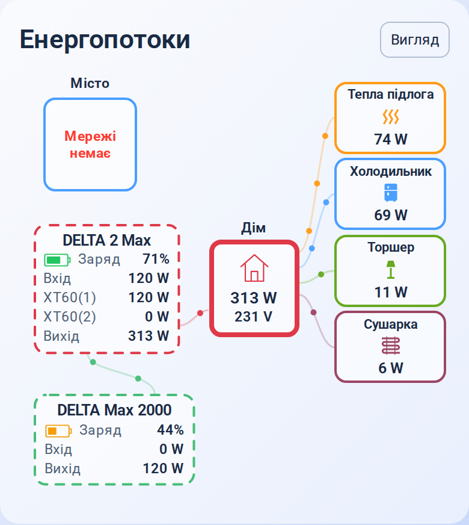

# 2.1.4-beta.1 — Battery layout preview / Попередній вигляд батарей

Це підготовлена бета у гілці `preview/2.1.4-beta.1`. Реліз і встановлення в Home Assistant ще не виконувались.

- Додано перемикач «Показувати другу допоміжну станцію» в її розділі редактора. Вимкнення прибирає блок та обидва його маршрути. Збережені сутності й розрахунок реального споживання залишаються доступними.
- Коли друга допоміжна станція прихована, у боковому вигляді блок першої ширший на 25%, головної — приблизно на 8%.
- У боковому вигляді головна й перша допоміжна станції мають значки батарей. Заповнення відповідає заряду: 0–20% — червоне, понад 20–50% — жовте, понад 50% — зелене. Недоступний заряд показано порожнім сірим значком із рискою.
- Демонстраційний варіант показує DELTA 2 Max та DELTA Max 2000; RIVER Max приховано. Показники на зображенні умовні.

Налаштування для цього варіанта (додаються до наявної конфігурації):

```yaml
auxiliary_2:
  visible: false
appearance:
  layout: sideflow
```

Попередні конфігурації з трьома станціями підтримуються: видимість другої допоміжної станції типово увімкнена. Перемикач дозволяє повернути її без повторного налаштування датчиків.

Відтворити зображення:

```sh
SURIS_PREVIEW_SHOT=sideflow-battery-beta npm run previews
```



## English

Prepared beta source for visual review only. No release, installation or production changes have been made.

- Hide the second auxiliary station and its routes with `auxiliary_2.visible: false` or the visual editor switch; retain its configured entities and power accounting.
- In Side flow, widen the remaining auxiliary station by 25% and the main station by about 8% when the second auxiliary is hidden.
- Show battery icons on the main and first auxiliary stations. Live fill and charge colors use their own sensors: red through 20%, amber through 50%, green above 50%; missing or invalid charge clears the fill and shows a grey dash.
- Preview DELTA 2 Max and DELTA Max 2000 without RIVER Max using demonstration readings.
