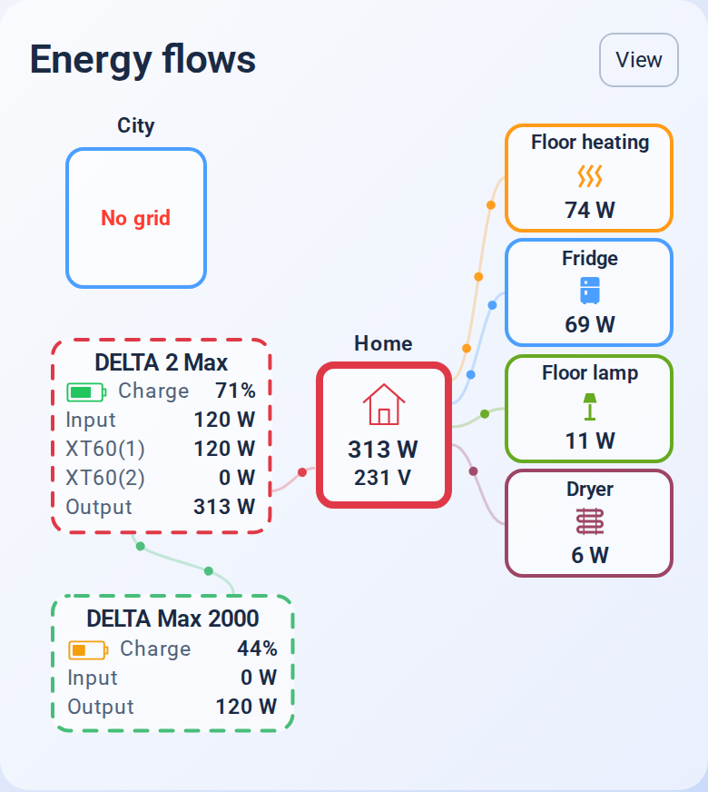

# 2.1.4 — Stable / Стабільний випуск

## Українська

Стабільний реліз на основі перевіреної **2.1.4-beta.1**. Функціональність та наявні налаштування збережено.

- Додано кольорові значки заряду в головній станції та першій допоміжній: червоний до 20%, жовтий до 50%, зелений понад 50%. Заповнення відповідає власному датчику кожної станції; недоступні показники показано порожнім сірим значком із рискою.
- Другу допоміжну станцію (RIVER Max у прикладі) можна прибрати разом з її двома лініями. У її розділі візуального редактора вимкни **«Показувати другу допоміжну станцію»**.
- Якщо друга допоміжна станція прихована, блок першої (DELTA Max 2000 у прикладі) ширший на 25%, головної — приблизно на 8%. Значки стоять у рядку «Заряд», зберігаючи компактну висоту.
- Збережено плавні лінії та наявні сутності. Приховування станції змінює її відображення; налаштовані датчики залишаються у розрахунку споживання.
- Виправлено узгодження SVG з висотою картки після зміни кількості видимих блоків.

**HACS:** онови картку до **2.1.4** та перезавантаж інтерфейс Home Assistant. Для вигляду на зображенні вимкни показ RIVER Max і вибери «Боковий потік».

Той самий варіант через YAML (додай до наявних відповідних розділів):

```yaml
auxiliary_2:
  visible: false
appearance:
  layout: sideflow
```

Попередні конфігурації з трьома станціями підтримуються: показ другої допоміжної станції типово увімкнено. Повернути її можна тим самим перемикачем.


Перевірено: усі наявні тести; ширини 320–1150 px; живе оновлення кольору та заповнення, недоступний заряд, незалежність датчиків, приховування й повернення другої допоміжної станції в обох виглядах. Стабільний реліз — **2.1.4**.

## English

Stable release based on the tested **2.1.4-beta.1**, preserving its functionality and existing configuration.

- Add live charge-colored battery icons to the main and first auxiliary stations: red through 20%, amber through 50%, green above 50%. Each icon uses its own charge sensor; unavailable readings clear the fill and show a grey dash.
- Hide the second auxiliary station and both of its routes using **Show the second auxiliary station** in its visual editor section, or `auxiliary_2.visible: false`.
- Widen the first auxiliary block by 25% and the main block by about 8% when the second auxiliary is hidden. Icons sit on the Charge row to retain compact height.
- Preserve smooth flow curves and configured entities. Hiding a station affects its display; configured sensors remain in power accounting.
- Keep the SVG viewport aligned with changes in diagram height.

In HACS, update the card to **2.1.4** and reload the Home Assistant frontend. To match the screenshot, hide RIVER Max and select Side flow. Existing configurations retain all three stations until the visibility switch is disabled.



Validation: complete existing regression suite; 320–1150 px widths; live charge colors and fill, unavailable readings, independent sensors, and hiding/restoring the second auxiliary station in both layouts. Stable release: **2.1.4**.
